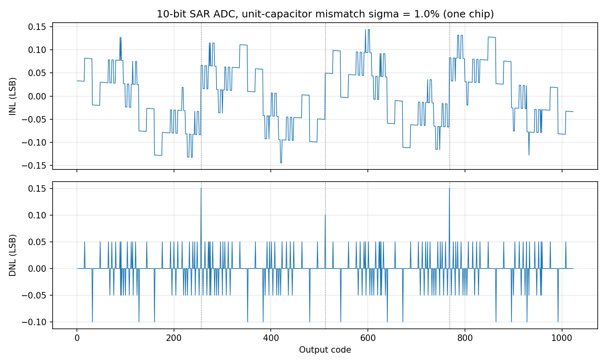
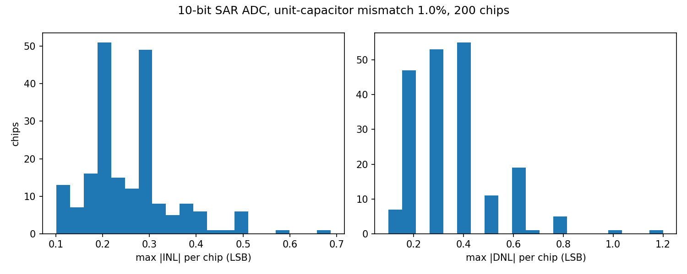
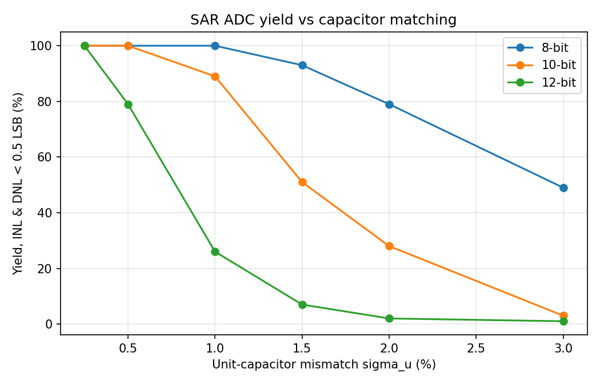
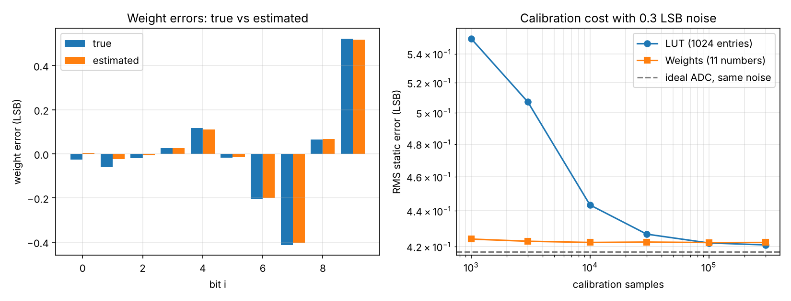
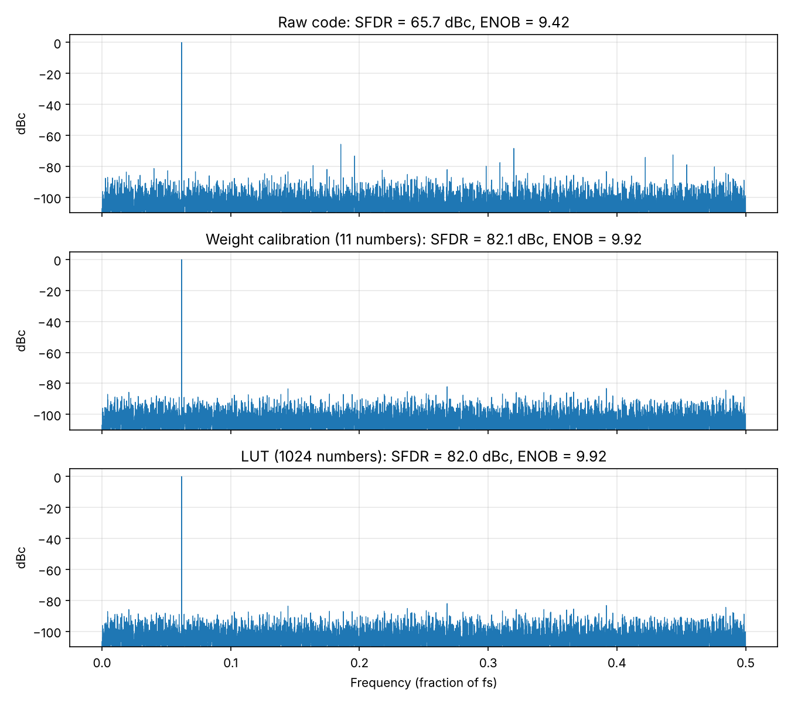

# SAR ADC: Capacitor Mismatch, Yield and Digital Calibration (Python + Verilog)

A behavioural model of an N-bit charge-redistribution SAR ADC in which every unit capacitor has a random error. The project measures how that mismatch turns into INL and DNL, runs a Monte Carlo over many chips to get yield against matching and resolution, calibrates the bit weights digitally, and implements the SAR control logic in Verilog, checked against the Python model.

## What each stage does

| Stage | File | What it does |
|---|---|---|
| 1. Model | `sar_model.py` | Builds the capacitor weights with random mismatch, runs the SAR binary search, and measures INL and DNL with a slow ramp |
| 2. Statistics | `mc_yield.py` | Runs many random chips; histograms of max INL and DNL; yield against mismatch and resolution |
| 3. Calibration | `sar_calibration.py` | Estimates the bit weights by least squares and compares with a lookup table and a small neural network |
| 4. Hardware | `sar_logic.v`, `tb_sar.v` | SAR state machine in Verilog, with a self-checking testbench and a Python cross-check |

## How the model works

- **Capacitor DAC.** Bit i is made of 2^i unit capacitors, plus one dummy unit, so the ideal total is 2^N units. Each unit has a relative error with standard deviation sigma_u. A group of m units therefore has a standard deviation of sigma_u*sqrt(m) (in units): large capacitors are relatively more accurate but have a larger absolute error.
- **Weights.** With actual capacitances C_i and total C_T, the weight of bit i in LSB is w_i = 2^N * C_i / C_T. A perfect array gives w_i = 2^i.
- **SAR search.** From the MSB down, each bit is tried (trial = level so far + w_i) and kept if the input is at least the trial level. The output code is read with the ideal weights 2^i, so any weight error appears as a code error.
- **Consequence.** The raw INL at a code is the sum of the weight errors of the bits that are set, INL(code) = sum of b_i * e_i with e_i = w_i - 2^i, before the best-fit line is removed. The DNL at a major carry is w_i minus the sum of all lower weights minus 1, with standard deviation sqrt(2^N - 1) * sigma_u at the MSB carry (32 * sigma_u for 10 bits).

INL in this project is measured against the least-squares best-fit line (offset and gain error removed), and DNL is the width of each code minus 1 LSB.

## Results

### 1. Static errors of one chip



For a perfect array the model gives 0 INL and 0 DNL, which is a basic check. For one 10-bit chip with 1% unit-capacitor mismatch (seed 7), the maximum INL is 0.14 LSB and the maximum DNL is 0.15 LSB. The DNL spikes sit at the major carries (codes 256, 512 and 768). Computed by hand from the chip's weights, the DNL at the 256 and 512 carries is 0.110 and 0.105 LSB, and the simulation measures 0.110 and 0.105 with 200 ramp points per LSB.

### 2. Monte Carlo and yield



10-bit, 1% mismatch, 200 chips:

| Quantity | Median | 95th percentile | Worst |
|---|---|---|---|
| max INL (LSB) | 0.24 | 0.41 | 0.69 |
| max DNL (LSB) | 0.30 | 0.60 | 1.20 |

The standard deviation of the MSB-carry DNL over the chips is 0.341 LSB, against 0.320 LSB predicted by sqrt(2^N - 1) * sigma_u.



Yield (a chip passes if max INL and max DNL are both below 0.5 LSB; 100 chips per point):

| Unit mismatch sigma_u | 0.25% | 0.5% | 1% | 1.5% | 2% | 3% |
|---|---|---|---|---|---|---|
| 8-bit | 100 | 100 | 100 | 93 | 79 | 49 |
| 10-bit | 100 | 100 | 89 | 51 | 28 | 3 |
| 12-bit | 100 | 79 | 26 | 7 | 2 | 1 |

Every two extra bits double the DNL in LSB, so the mismatch that can be tolerated halves. At fixed yield, that means roughly 16 times more capacitor area for two more bits, assuming sigma_u scales as 1/sqrt(unit area).

### 3. Digital calibration of the bit weights

The SAR decides each bit with the real weights, so the output can be rebuilt as y = c + sum of b_i * w_hat_i. The weights and the offset c are estimated by least squares from known calibration inputs. This needs N + 1 = 11 numbers, against 1024 for a lookup table (LUT).

Chip with 3% mismatch, input at 95% of full scale (coherent sine, 16,384 samples), no noise:

| Output | RMS error (LSB) | ENOB (bits) | SFDR (dBc) |
|---|---|---|---|
| Ideal ADC | 0.288 | 9.93 | 83.0 |
| Raw code | 0.433 | 9.42 | 65.7 |
| Weight calibration (11 numbers) | 0.291 | 9.92 | 82.1 |
| LUT (1024 entries) | 0.290 | 9.92 | 82.0 |
| Neural network on the code | 0.307 | 9.84 | 82.0 |

The estimated weight errors match the true ones to within about 0.035 LSB.



With 0.3 LSB rms of input noise, the RMS static error against the number of calibration samples is:

| Calibration samples | 1,000 | 3,000 | 10,000 | 30,000 | 100,000 |
|---|---|---|---|---|---|
| Weights (11 numbers) | 0.424 | 0.423 | 0.422 | 0.422 | 0.422 |
| LUT (1024 entries) | 0.551 | 0.507 | 0.443 | 0.427 | 0.422 |

An ideal ADC with the same noise gives 0.417 and the uncalibrated chip gives 0.531. The weight calibration is close to ideal with about 1,000 samples, while the LUT needs about 30,000, and at 1,000 samples it is worse than no calibration. Fewer parameters learn faster, because the error really consists only of N capacitor weights.



For larger mismatch (1%, 3% and 6%) the median RMS residual after calibration stays close to the ideal 0.289 LSB (0.289, 0.294 and 0.311). At 6%, about 0.2% of the inputs still show a residual above 1 LSB: these are inputs near a major carry where the SAR made a wrong decision, which no calibration can undo. Real designs avoid this with redundancy.

### 4. Verilog SAR logic

`sar_logic` is an N-bit state machine with a one-hot mask that tracks the bit under test.

| Port | Direction | Meaning |
|---|---|---|
| `clk`, `rst_n` | in | Clock, active-low asynchronous reset |
| `start` | in | Pulse high for one clock to start a conversion |
| `comp_in` | in | Comparator output: 1 if Vin >= Vdac |
| `sar_out` | out | Trial code during conversion, final result when `valid` = 1 |
| `valid` | out | Level, high from the end of a conversion until the next start |
| `done` | out | One-clock pulse on the edge on which `valid` rises |
| `sample` | out | High while idle, so the sample-and-hold can track Vin (low for N cycles during a conversion) |

A conversion takes 11 clock edges for N = 10: one start edge and ten decision edges. Example (ideal 10-bit chip, Vin = 300.0 LSB, values sampled at each rising edge before it updates them):

```
start=1  mask=0000000000  sar_out=0100101011  (previous result)
start=0  mask=1000000000  sar_out=1000000000  comp_in=0  -> clear bit 9
start=0  mask=0100000000  sar_out=0100000000  comp_in=1  -> keep bit 8
start=0  mask=0010000000  sar_out=0110000000  comp_in=0  -> clear bit 7
...
start=0  mask=0000000001  sar_out=0100101101  comp_in=0  -> clear bit 0
start=0  mask=0000000000  sar_out=0100101100  valid=1  done=1   (= 300)
```

The full trace is in `results/example_trace.txt`.

Verification (Icarus Verilog 12.0; the DAC and comparator in the testbench are behavioural models):

- For an ideal chip, a 1% chip and a 3% chip, 12,224 inputs each (a ramp, exact integers, values at the major carries, and random values): zero mismatches against the Python model and against the golden model inside the testbench.
- N = 1, 2, 4, 8, 12 and 16 with 3,003 inputs each: zero mismatches.
- Also simulated in Vivado (xsim) for the 1% mismatch chip with 12,224 inputs: the testbench reports PASS (0 mismatches against the golden model, 12,224 done pulses, 0 sample errors), and the codes it wrote match the Python model with 0 mismatches (`results/vivado_console.png`, `results/python_comparison.png`).
- Directed tests in `tb_extra.v`: normal conversion, `valid` held until the next start, reset in the middle of a conversion, restart by a second start pulse, and start held high.
- One `done` pulse per conversion, and `sample` low for exactly N cycles per conversion.

## Files

| File | Purpose |
|---|---|
| `sar_model.py` | Capacitor-array model, SAR search, INL and DNL measurement |
| `mc_yield.py` | Monte Carlo over chips, histograms and yield |
| `sar_calibration.py` | Weight calibration, LUT and neural-network comparison, calibration-cost experiment |
| `sar_logic.v` | Verilog SAR state machine |
| `tb_sar.v` | Self-checking testbench with a golden model and a clock-by-clock trace |
| `tb_extra.v` | Directed tests (reset, restart, held start, valid and done behaviour) |
| `verilog_check.py` | Generates test files and cross-checks the Verilog output against the Python model |
| `results/` | Plots and the example trace |
| `docs/` | Hand calculations |
| `requirements.txt` | Python packages |

## How to run

Python 3 with the packages in `requirements.txt` (`pip install -r requirements.txt`). All random seeds are fixed, so the results are reproducible.

```
python sar_model.py          # one chip, INL/DNL plot
python mc_yield.py           # Monte Carlo and yield plots
python sar_calibration.py    # calibration experiments and plots
python verilog_check.py      # Verilog vs Python (needs iverilog and vvp)
```

With Vivado instead of Icarus: run `python verilog_check.py generate`, add `sar_logic.v` as a design source and `tb_sar.v` as a simulation source (top module `tb_sar`), copy `weights.txt` and `inputs.txt` into the simulation working folder, run the behavioural simulation, copy `codes_verilog.txt` back, then run `python verilog_check.py compare`. Each script writes its plots into the current folder.

## Limitations

- The ADC is a behavioural model. The DAC and comparator in the Verilog testbench are also behavioural (real-valued weights), and the Verilog has not been synthesised or run on an FPGA board.
- The calibration uses known, exact input values. A real chip needs an accurate reference signal or an on-chip calibration source.
- Only static, code-dependent errors are modelled. Dynamic errors (frequency-dependent), kT/C noise, comparator offset and noise, and settling are not included, apart from the simple input noise in the calibration-cost experiment.
- The SAR is not redundant, so wrong decisions near a major carry cannot be corrected.
- The Monte Carlo uses 100 to 200 chips per point and a ramp with 10 points per LSB, so the DNL values are resolved to about 0.1 LSB and the extreme values vary between runs. Means, medians and standard deviations are more stable.
- The area figure assumes sigma_u scales as 1/sqrt(unit area), which is a rule of thumb.

## Possible extensions

- Add a redundant capacitor so that decision errors can be recovered.
- Model comparator noise and offset, and DAC settling.
- Synthesise `sar_logic` for an FPGA and test it on a board.
- Background calibration without a precise reference signal.
